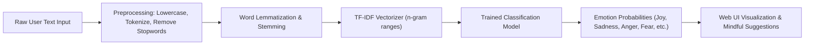

# 🎭 MoodPlus NLP — Real-Time Emotion & Sentiment Intelligence

<p align="center">
  
</p>

<p align="center">
  A natural language processing application that classifies user emotional states (Joy, Sadness, Anger, Fear, Surprise, Love) from unstructured free-form text inputs using TF-IDF token vectorization, machine learning classification, and an interactive web interface.
</p>

<p align="center">
  <a href="https://github.com/prakruthidevanga/MoodPlus-NLP">
    
  </a>
</p>

<p align="center">
  
  
  
  
</p>

---

## 📌 Table of Contents

- [📖 Project Overview](#-project-overview)
- [🎯 Objectives](#-objectives)
- [✨ Key Features](#-key-features)
- [🏗️ NLP Processing Pipeline](#️-nlp-processing-pipeline)
- [🛠️ Technology Stack](#️-technology-stack)
- [📁 Repository Structure](#-repository-structure)
- [⚙️ Installation and Setup](#️-installation-and-setup)
- [🔮 Future Enhancements](#-future-enhancements)
- [🤝 Contributing](#-contributing)
- [👩‍💻 Author & Accreditations](#-author--accreditations)

---

## 📖 Project Overview

Understanding sentiment and nuanced human emotions from text is essential for digital well-being apps, customer service triage, and feedback analysis. Conventional binary sentiment models (positive vs. negative) miss critical human emotions like anxiety, grief, anticipation, or empathy.

**MoodPlus NLP** provides a fine-grained emotion detection system trained to categorize free-form reflections and messages into 6 distinct psychological emotional states. By integrating rigorous text cleaning (stopword removal, lemmatization, tokenization), TF-IDF feature extraction, and high-precision classification models, MoodPlus delivers instant emotional feedback paired with supportive recommendations.

🎭 **Core Mission:** Provide accessible, non-diagnostic computational emotional intelligence to promote mindful digital self-reflection.

---

## 🎯 Objectives

- 📝 **Multi-Class Emotional Mapping:** Move beyond binary polarity to detect Joy, Sadness, Anger, Fear, Love, and Surprise.
- 🧹 **Robust Text Preprocessing:** Clean noisy social text by handling punctuation, lowercase conversion, and lemmatization.
- 📐 **High-Dimensional Feature Engineering:** Transform variable-length text strings into term frequency-inverse document frequency (TF-IDF) feature vectors.
- ⚡ **Lightweight Real-Time Inference:** Maintain sub-50ms latency for seamless browser interaction.
- 🛡️ **Ethical & Mindful Positioning:** Transparently explain that classifications are algorithmic text patterns, not clinical mental health evaluations.

---

## ✨ Key Features

### 🔍 1. Real-Time Emotion Inference
Instantaneous text analysis providing predicted dominant emotion and confidence distribution bars.

### 📊 2. Multi-Class Confidence Breakdown
Visual breakdown displaying probabilities across all evaluated emotion categories.

### 💡 3. Mood-Adaptive Suggestions
Context-aware reflective prompts and wellness suggestions tailored to the detected emotional state.

### 🌐 4. Self-Contained Web Portal
Lightweight, accessible frontend (`Moodpulse_Website_NLP.html`) offering a clean responsive user interface without heavy client dependencies.

---

## 🏗️ NLP Processing Pipeline



---

## 🛠️ Technology Stack

<p align="center">
  
</p>

| Component | Technology | Implementation Details |
| :--- | :--- | :--- |
| **Language & Environment** | Python 3.9+ | Model training, evaluation, and pipeline assembly |
| **NLP & Machine Learning** | Scikit-learn, NLTK | TF-IDF vectorizer, text tokenization, classifier benchmarks |
| **Data Manipulation** | Pandas, NumPy | Dataset loading, class balancing, and metric evaluation |
| **Web Presentation** | HTML5, CSS3, JavaScript | Lightweight, responsive browser interface |

---

## 📁 Repository Structure

```text
MoodPlus-NLP/
├── Emotion_Detection_NLP_Code.ipynb    # Complete model training, evaluation, and tuning notebook
├── Moodpulse_Website_NLP.html          # Interactive client application interface
├── NLP_Project_Report.zip              # Formal academic research documentation and findings
└── README.md                           # Project documentation
```

---

## ⚙️ Installation and Setup

### Prerequisites
- Python 3.8+
- Jupyter Notebook
- Modern web browser

### Step 1: Clone Repository
```bash
git clone https://github.com/prakruthidevanga/MoodPlus-NLP.git
cd MoodPlus-NLP
```

### Step 2: Set Up Environment
```bash
python -m venv .venv
.\.venv\Scripts\Activate.ps1
pip install scikit-learn pandas numpy matplotlib seaborn nltk jupyter
```

### Step 3: Run the Training Notebook
```bash
jupyter notebook Emotion_Detection_NLP_Code.ipynb
```

### Step 4: Open the Web Application
Simply launch `Moodpulse_Website_NLP.html` directly in any modern browser!

---

## 🔮 Future Enhancements

- 🤖 **Transformer Embeddings:** Upgrade from TF-IDF to contextual embeddings using BERT / RoBERTa models.
- 🎙️ **Voice Emotion Recognition:** Integrate speech-to-text to detect emotional sentiment from audio recordings.

---

## 🤝 Contributing

Contributions, feature ideas, and model improvements are warmly welcomed!

---

## 👩‍💻 Author & Accreditations

**Prakruthi B R**  
*BCA Student specializing in Artificial Intelligence & Machine Learning*  
*Alliance University, Bengaluru (CGPA: 9.60)*  
*GeeksforGeeks Campus Mantri (2026)*

- 💻 **GitHub:** [@prakruthidevanga](https://github.com/prakruthidevanga)
- 🔗 **LinkedIn:** [Prakruthi BR](https://linkedin.com/in/prakruthi-br)
- 🌐 **Portfolio:** [prakruthidevanga.github.io](https://prakruthidevanga.github.io/)
- 📬 **Email:** [prakruthibr2006@gmail.com](mailto:prakruthibr2006@gmail.com)

---

<p align="center">
  <b>🎭 Bridging computation and empathy through natural language understanding.</b>
</p>

<p align="center">
  
</p>
